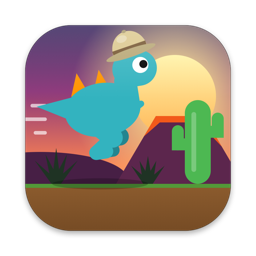
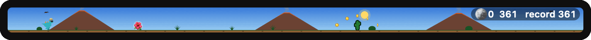
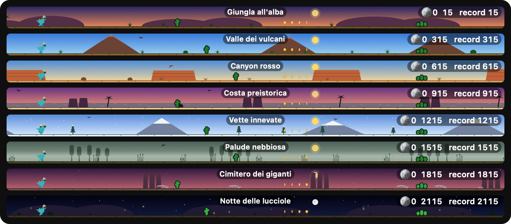
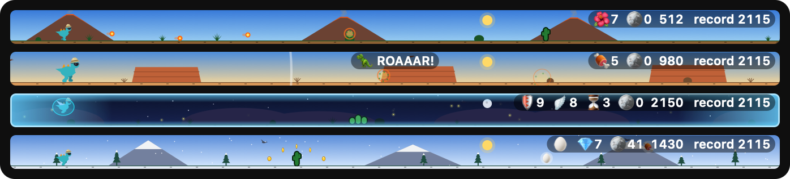
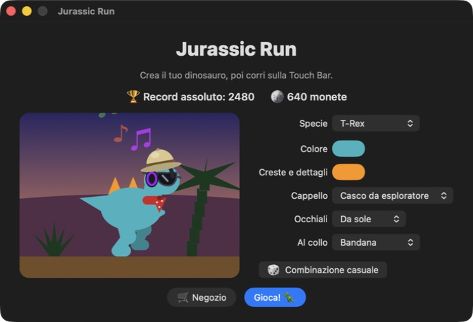
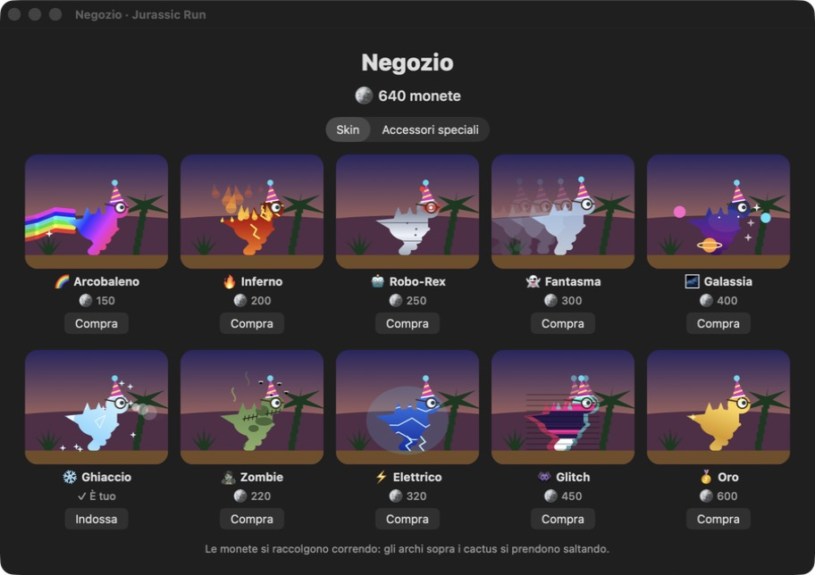
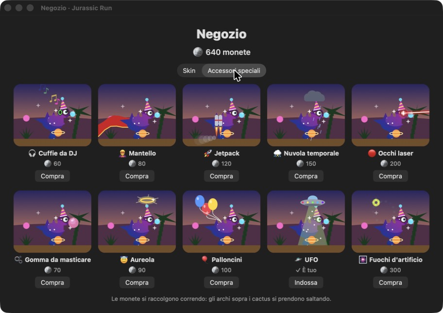
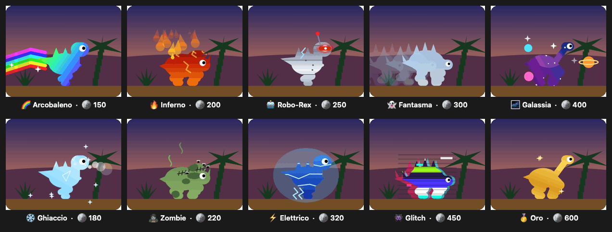
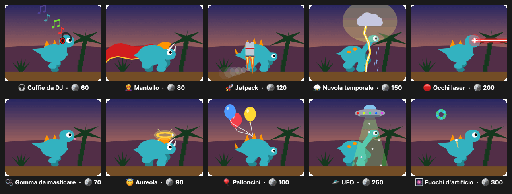

<p align="center"></p>

# Jurassic Run

Un gioco di corsa per la **Touch Bar** del MacBook Pro: un dinosauro corre, salta i cactus, raccoglie monete e power-up e attraversa otto ambientazioni preistoriche. Grafica, musica chiptune ed effetti sonori sono generati interamente dal codice: nessun file di immagine o audio.



**[⬇️ Scarica l'ultima versione](https://github.com/AlbyToniolo-byte/jurassic-run/releases/latest)**

## Comandi

| Azione | Touch Bar | Tastiera |
|---|---|---|
| Salta (doppio salto con le ali) | tocca la barra | ↑ o Spazio |
| Spara (col fiore di fuoco) | tocca la metà destra | → o F |
| Pausa | Esc della Touch Bar | Esc |
| Audio on/off | — | M |

Tieni la finestra del gioco in primo piano: macOS mostra la Touch Bar solo dell'app attiva (passando a un'altra app il gioco va in pausa da solo).

## Otto ambientazioni

Ogni 300 punti cambia lo scenario, con sfondi, meteo e musica diversi (a ogni cambio la colonna sonora aggiunge o toglie uno strato).



## Power-up



Ognuno ha il suo effetto sonoro.

| | Power-up | Effetto |
|---|---|---|
| 🛡️ | Scudo | assorbe un cactus |
| 🪽 | Ali | doppio salto |
| ⏳ | Clessidra | rallenta il mondo (con bagliore ai bordi ed effetto Doppler sulla musica) |
| 🌺 | Fiore di fuoco | palle di fuoco che rimbalzano e spaccano i cactus |
| 🥚 | Uovo | vita extra, resta finché non serve |
| 🍖 | Bistecca | diventi gigante e schiacci i cactus |
| 🦖 | Ruggito | spazza via tutti i cactus sullo schermo |
| 💎 | Ambra | punti doppi |

## Personalizza il dinosauro

Quattro specie (T-Rex, Triceratopo, Stegosauro, Brachiosauro), colori a scelta, sei cappelli, quattro paia di occhiali e tre accessori al collo. Nella finestra principale ci sono anche il record assoluto e le monete.



## Negozio

Le monete si raccolgono correndo (gli archi sopra i cactus si prendono saltando) e restano salvate tra una partita e l'altra. Nel negozio si spendono per **10 skin** e **10 accessori speciali** animati, divisi in due pagine. Ogni scheda mostra il tuo dinosauro con l'oggetto addosso.





### Skin



### Accessori speciali



## Installazione

Serve un **MacBook Pro con Touch Bar** e **macOS 13** o successivo (Apple Silicon o Intel).

1. Scarica `JurassicRun.zip` dall'[ultima release](https://github.com/AlbyToniolo-byte/jurassic-run/releases/latest), estrai e sposta **Jurassic Run** in Applicazioni.
2. L'app non è firmata con un certificato Apple, quindi al primo avvio macOS la blocca: apri **Impostazioni di Sistema → Privacy e sicurezza** e premi **Apri comunque**. In alternativa, dal Terminale:
   ```bash
   xattr -dr com.apple.quarantine "/Applications/Jurassic Run.app"
   ```

## Compilare dal codice

Bastano gli strumenti da riga di comando di Xcode (`xcode-select --install`).

```bash
./build.sh           # esegue i test, crea "Jurassic Run.app" (universale) con l'icona
./build.sh install   # come sopra, e la copia in /Applications
```

Tutto il gioco è in [`main.swift`](main.swift): AppKit per finestra e Touch Bar (`NSCustomTouchBarItem`), disegno con `NSBezierPath` a 60 fotogrammi al secondo, musica e suoni sintetizzati con AVFoundation. `./build.sh` lancia prima un self-test (fisica, power-up, monete, negozio, salvataggi, audio).
